<!--
  GitHub Profile README
  Joshua Vinu Koshy | joshua16vinu
-->

<div align="center">
  

  <br/>

  <p>
    <a href="https://joshuavinukoshy.vercel.app/">portfolio</a>
    &nbsp;·&nbsp;
    <a href="https://www.linkedin.com/in/joshua-vinu-koshy-8328b7287/">linkedin</a>
    &nbsp;·&nbsp;
    <a href="mailto:joshuvk16@gmail.com">email</a>
  </p>

  

</div>

---

## `01` / A little about me

```yaml
name: Joshua Vinu Koshy
location: Stuttgart, Germany
education:
  degree: MSc Computer Science
  university: University of Stuttgart
  focus: Autonomous Systems

interests:
  - Machine Learning & AI
  - Autonomous Systems
  - Agentic AI & LLMs
  - Distributed Systems
  - Machine Perception
  - Intelligent Applications

currently:
  learning: Advanced Computer Science
  building: AI-powered systems
  exploring: Research & engineering
```

I'm a Computer Science postgraduate student at the **University of Stuttgart**, interested in understanding and building intelligent systems.

My work has involved developing AI-driven applications, multi-agent workflows, financial intelligence systems, and offline AI tools. I'm particularly interested in the engineering behind these systems — how models, data, memory, and distributed components work together.

I enjoy moving between research, experimentation, and implementation.

---

## `02` / What I'm interested in

<table>
<tr>
<td width="50%" valign="top">

### 🧠 Machine Learning

Deep learning, representation learning, model architectures, and intelligent perception.

</td>
<td width="50%" valign="top">

### 🤖 Agentic Systems

LLM-based agents, orchestration, MCP, memory architectures, and multi-agent collaboration.

</td>
</tr>
<tr>
<td width="50%" valign="top">

### 🌐 Distributed Systems

System models, communication, consistency, scalability, and fault tolerance.

</td>
<td width="50%" valign="top">

### 🔬 Autonomous Systems

Machine perception, decision-making, learning, and intelligent environments.

</td>
</tr>
</table>

---

## `03` / Selected engineering

<table>
<tr>
<td width="50%" valign="top">

<h3>01. Financial Intelligence</h3>

**Financial Assistant using Agentic Workflows and Long-Term Memory (MCP)**

An agent-based financial assistance system developed during my internship at InfinityPool Finnotech.

- Fundamental, technical and sentiment agents
- Stock screening and portfolio analysis
- Long-term context and memory
- Financial decision-support workflows

<sub>Python · n8n · MCP · PostgreSQL · Supabase · Streamlit</sub>

</td>
<td width="50%" valign="top">

<h3>02. PolicyGuard AI</h3>

**Offline AI for Cybersecurity Policy Analysis**

An offline policy gap-analysis and revision system built around NIST CSF 2.0.

- Local LLM inference with Ollama
- Semantic retrieval and persistent ChromaDB
- Policy-to-framework mapping
- Automated policy revision

<sub>Python · FastAPI · React · Ollama · ChromaDB</sub>

<br/>

🏆 **3rd Place — Hack IITK 2026, C3iHub**

</td>
</tr>
<tr>
<td width="50%" valign="top">

<h3>03. Precision Healthcare</h3>

**Towards Autonomous Precision Healthcare**

Research exploring the intersection of AI and precision healthcare.

- Representation
- Reasoning
- Action
- Simulation

<sub>AI · Machine Learning · Healthcare Research</sub>

</td>
<td width="50%" valign="top">

<h3>04. Quantitative Systems</h3>

**Financial Backtesting & Market Intelligence**

Engineering data-driven workflows for financial analysis and strategy evaluation.

- Historical market data pipelines
- Technical indicators and pattern analysis
- Strategy backtesting
- Risk and performance metrics

<sub>Python · Backtrader · PostgreSQL · Financial APIs</sub>

</td>
</tr>
</table>

---

## `04` / Technology landscape

<div align="center">

**LANGUAGES**


**AI / MACHINE LEARNING**


**WEB & BACKEND**


**DATABASES, CLOUD & INFRASTRUCTURE**


</div>

<details>
<summary><b>More tools and technologies</b></summary>

- **LLMs & orchestration:** LangChain, LangGraph, n8n, MCP
- **Vector databases:** FAISS, ChromaDB
- **Data science:** NumPy, Pandas, Matplotlib, Seaborn
- **Financial tools:** Backtrader, FMP API
- **Automation:** Selenium, BeautifulSoup, Scrapy, Playwright
- **Developer tools:** VS Code, Jupyter, GitHub Actions

</details>

---

## `05` / Beyond the code

<div align="center">


<br/>


<br/>


</div>

---

## `06` / Find me elsewhere

<div align="center">

<a href="https://joshuavinukoshy.vercel.app/">

</a>
<a href="https://www.linkedin.com/in/joshua-vinu-koshy-8328b7287/">

</a>
<a href="https://github.com/joshua16vinu">

</a>
<a href="mailto:joshuvk16@gmail.com">

</a>

<br/><br/>

<i>Curiosity drives the questions. Engineering turns them into systems.</i>


</div>
